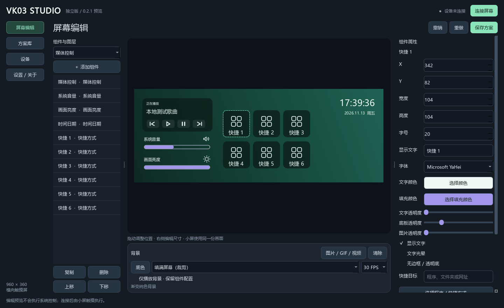
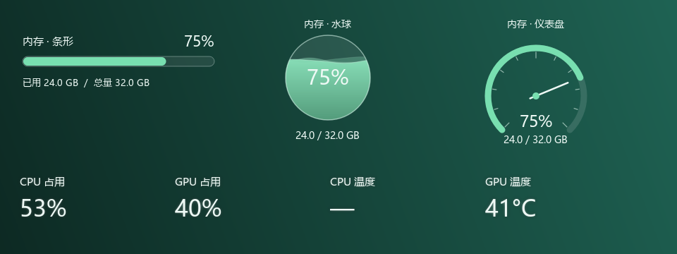
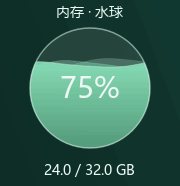

# VK03 Studio

[简体中文](README.md) · **English**

An independent Windows control panel for the Valkyrie VK03 touchscreen, with media controls, system volume, customizable shortcuts, PC monitoring and image/GIF/video backgrounds.

**Studio 0.2.1 preview · Windows 10/11 x64 · 960 × 360**

[Download the complete Windows package](https://github.com/bondwang666-k9999w11/vk03-home-panel/releases/tag/studio-v0.2.1) · [Usage guide (Chinese)](docs/USAGE.md) · [Changes from factory extension 0.3.0](docs/COMPARISON-0.3.0.md)

This is the **vk03-studio branch**. The Home Assistant edition remains on [main](https://github.com/bondwang666-k9999w11/vk03-home-panel/tree/main). Studio does not require HA or a running MythTool instance. A compatible USB driver is still required.

## Features

- Independent Qt editor, renderer and direct USB/HID transport; no bundled MythCool.exe, vendor JSC or native .node addon.
- Movable/resizable widgets, layers, duplication, undo/redo and automatic saving.
- Font, size, color, visibility and opacity controls; cropped button images and reusable styles.
- Media title/playback, volume dragging/mute, custom shortcuts, double-tap power controls and date/time.
- Optional glow and shared text styles for the four CPU/GPU metrics.
- Three memory widgets: progress bar, animated layered liquid ball and needle gauge, with used/total RAM.
- Image/GIF/video backgrounds, 15/30 FPS targets, background-only mode and software dimming.
- Portable .vk03 schemes including assets, tray operation, reconnect and a manifest-based uninstaller.

## Quick start

1. Download **VK03Studio-0.2.1-preview-win64.zip** from the Studio release, not GitHub's automatic Source code archive.
2. Extract the **entire folder** and run VK03Studio.exe. Keep _internal alongside the EXE. Python is not needed for the packaged app.
3. Fully exit other VK03 controllers and MythTool, including their tray instances, before selecting Connect.
4. Add widgets on the left, drag them in the preview, and edit properties on the right. Background settings are below the preview.
5. Close the window to keep running in the tray. Use the tray Exit action to stop completely.

Upgrade by exiting the old version and extracting the complete new package into a new folder. Existing Studio schemes use the same user data location. To uninstall, exit that version and run its uninstall.exe; personal schemes/assets and modified or additional files are retained.

## Compatibility

Verified hardware profile: MS912C 360×960 VK03, display 345F:9132, touch 374A:A401, Bulk OUT 0x04. Other firmware/orientations remain unverified. The program does not install, replace or uninstall USB drivers.

CPU/RAM usage is collected locally. NVIDIA GPU data requires nvidia-smi; CPU temperature requires an existing LibreHardwareMonitor WMI service. AMD/Intel GPU collection is not implemented. Missing metrics show “—”. Dimming affects the image rather than physical backlight. FPS values are targets, not guarantees.

Vendor skins/private layouts are not automatically converted. Studio has a separate version line from factory extension 0.3.0. Screenshots and the GIF use demonstration values; the running application reads local data.

## Development and licensing

See [build and tests](docs/BUILD.md), [FAQ](docs/FAQ.md) and [changelog](CHANGELOG.md). Report issues with [Studio] in the title and redact private paths, URL parameters and secrets.

Project-owned code is MIT licensed; dependencies retain their licenses. See [LICENSE](LICENSE), [third-party notices](THIRD_PARTY_NOTICES.txt) and licenses/. This is an independent community project, unaffiliated with the manufacturers and brands mentioned.
