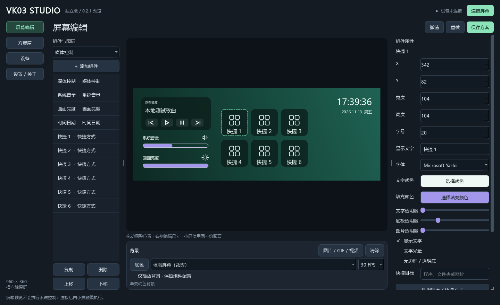
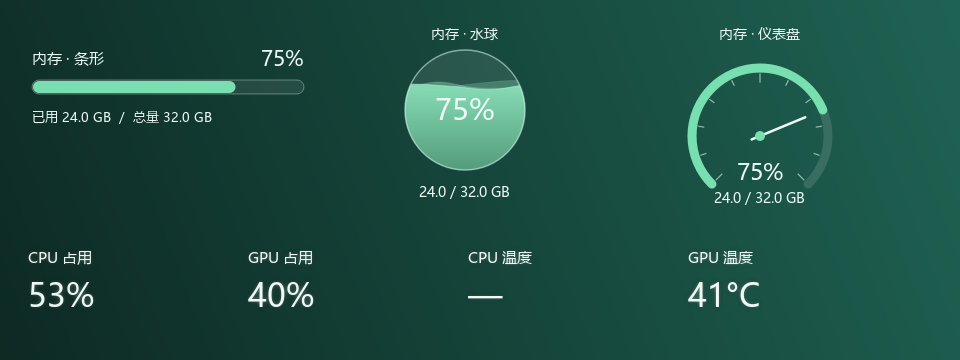
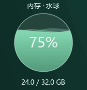

# VK03 Studio

**简体中文** · [English](README.en.md)

面向瓦尔基里 VK03 触摸屏的独立 Windows 控制面板：媒体控制、系统音量、快捷方式、PC 监控，以及图片 / GIF / 视频背景。

**当前版本：Studio 0.2.1（测试版） · Windows 10/11 x64 · 960 × 360**

[下载完整程序包](https://github.com/bondwang666-k9999w11/vk03-home-panel/releases/tag/studio-v0.2.1) · [完整使用教程](docs/USAGE.md) · [与原厂扩展版 0.3.0 对比](docs/COMPARISON-0.3.0.md) · [常见问题](docs/FAQ.md)

> 本页面属于 **vk03-studio 分支**。米家 / Home Assistant 版本继续保留在 [main 分支](https://github.com/bondwang666-k9999w11/vk03-home-panel/tree/main)。Studio 不需要 HA，也不需要启动 MythTool；连接屏幕仍需系统已有兼容 USB 驱动。

## 界面

中文编辑工作台：左侧组件与图层，中间完整等比预览，右侧属性，底部背景设置。

截图与动图使用示例数据；程序运行时读取本机数据。

## 能做什么

- **独立运行**：自己的 Qt 桌面界面、画面渲染与 USB/HID 通信，不加载 MythCool.exe、原厂 JSC 或 .node。
- **自由排布**：拖动、复制、调整尺寸与图层顺序；撤销 / 重做、自动保存。
- **外观编辑**：字体、字号、文字颜色、显隐、文字 / 底板 / 图片透明度；按钮图片自动居中裁剪铺满。
- **媒体与音量**：歌名、播放 / 暂停 / 上下曲，滑动系统音量、点击静音；音量图标随音量显示 1–3 道波纹。
- **触屏快捷方式**：程序、文件、文件夹、`.lnk` 或 HTTP(S) 网址；可创建多个独立按钮。
- **PC 监控**：CPU/GPU 占用与温度文字组件，可选光晕；四项之间一键套用文字样式，保留各自内容、位置和尺寸。
- **三款内存组件**：条形、水球、指针仪表盘，显示百分比与已用 / 总物理内存；水球液面有三层错速波浪动画。
- **背景播放**：图片、GIF、视频，裁剪填满 / 完整显示，目标 15 / 30 FPS；支持只播放背景并保留全部组件配置。
- **设备管理**：连接 / 断开、连接成功后的断线重连、画面亮度；后台托盘运行。
- **方案分享**：`.vk03` 方案可连同素材一起导入 / 导出。
- **卸载入口**：程序同目录提供 `uninstall.exe`，按清单移除程序文件，保留方案、素材和自行修改的文件。

### 内存与发光文字

动态水球示意（75%、24 / 32 GB 为示例数据）：

## 第一次运行

1. 从 [Studio 0.2.1 Release](https://github.com/bondwang666-k9999w11/vk03-home-panel/releases/tag/studio-v0.2.1) 下载 **`VK03Studio-0.2.1-preview-win64.zip`**。
2. **完整解压**到自己的文件夹，例如 `D:\Apps\VK03Studio`。保留 `_internal`，不要只复制 EXE。
3. 运行 `VK03Studio.exe`。编辑和保存方案不需要连接小屏。
4. 完全退出其他 VK03 面板和 MythTool（包括托盘），再点击右上角 **连接屏幕**。
5. 左侧添加组件、在预览里拖动，右侧修改样式；背景在预览下方设置。

GitHub 自动生成的 **Source code** 是源码，不是可直接启动的 Windows 程序包。更详细的操作见 [使用教程](docs/USAGE.md)。

## 支持范围

| 项目 | 当前支持 |
| --- | --- |
| 系统与设备 | Windows 10/11 x64；已验证的 360 × 960 MS912C VK03，横向画面 960 × 360 |
| 显示 / 触摸 ID | 显示 `345F:9132`，触摸 `374A:A401`；显示 Bulk OUT `0x04` |
| USB 驱动 | 使用已有匹配的 libusb0 驱动与 64 位库；不会自动安装、替换或卸载驱动 |
| CPU / 内存占用 | 直接读取本机系统数据 |
| NVIDIA GPU | 系统需已有可用的 `nvidia-smi` |
| CPU 温度 | 系统需已有 LibreHardwareMonitor WMI 传感器服务 |
| AMD / Intel GPU | 当前未接入，显示缺失值 |
| 缺失数据 | 显示 `—`，不用演示数值代替 |
| 画面亮度 | 软件调暗，未控制硬件背光 |
| 原厂皮肤 | 未自动搬入独立版；提供三套原创初始布局 |
| 旧版方案 | 不自动导入原厂私有布局；已有 Studio 方案保持兼容 |

15 / 30 FPS 是输出目标，实际取决于视频解码、USB 和主机性能。当前设备已有用户实屏验收反馈，其他硬件、驱动和固件组合仍需验证。独立版版本线与原厂扩展版分开计数，因此 **Studio 0.2.1 与原厂扩展版 0.3.0 属于不同产品阶段**。

## 文档与反馈

- [完整使用教程：安装、布局、背景、监控、升级与卸载](docs/USAGE.md)
- [与原厂扩展版 0.3.0 的变化和保留项](docs/COMPARISON-0.3.0.md)
- [常见问题与排错](docs/FAQ.md)
- [源码运行、构建和开发验证](docs/BUILD.md)
- [更新记录](CHANGELOG.md)

问题请提交到 [Issues](https://github.com/bondwang666-k9999w11/vk03-home-panel/issues)，标题注明 **[Studio]**，附上程序版本、Windows 版本、设备型号和错误提示。分享配置或日志前隐藏个人路径、网址参数与密钥。

## 开源说明

本项目自有代码采用 [MIT](LICENSE)。Qt、Pillow、HID/USB 库等依赖保留各自许可证，见 [第三方说明](THIRD_PARTY_NOTICES.txt) 和 `licenses/`。发布包不包含原厂程序、皮肤、用户配置或背景素材。这是独立社区项目，与瓦尔基里、Myth.Cool、360 及其他提及的品牌无官方隶属关系。
