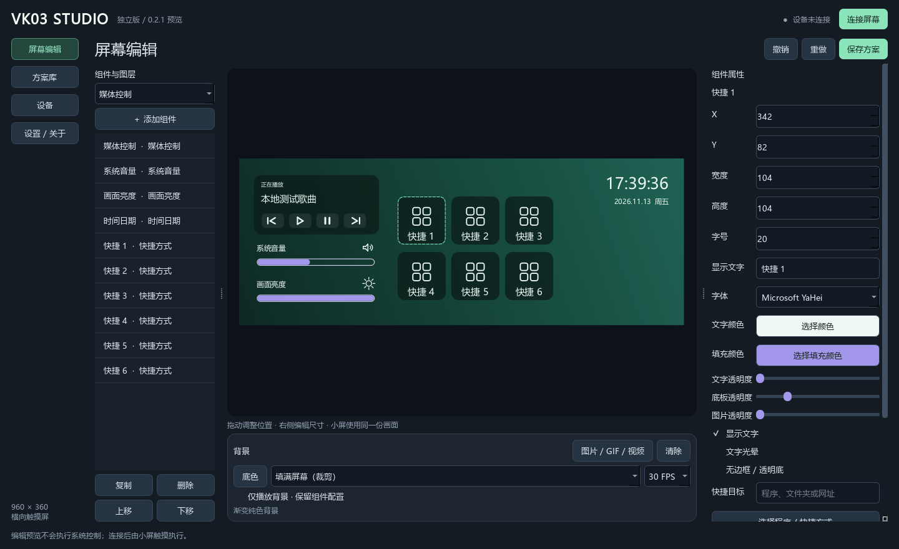
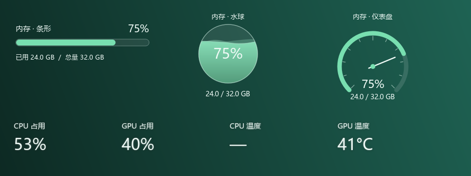
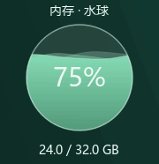

# VK03 Studio 使用教程

[返回首页](../README.md) · [下载 Studio 0.2.1](https://github.com/bondwang666-k9999w11/vk03-home-panel/releases/tag/studio-v0.2.1)

## 一、准备与首次启动

### 下载哪个文件

在 Release 的 Assets 中选择 **VK03Studio-0.2.1-preview-win64.zip**。这是完整 Windows 程序，无需自己安装 Python。

`VK03Studio-0.2.1-source.zip` 和 GitHub 自动生成的 Source code 面向开发者，不能直接当成程序运行。

### 解压与打开

1. 新建自己的程序文件夹，例如 `D:\Apps\VK03Studio`，把 ZIP **完整解压**进去。
2. 确认 `VK03Studio.exe`、`uninstall.exe`、`_internal` 等文件仍在同一个程序目录。
3. 双击 `VK03Studio.exe` 打开编辑器。
4. 可以先离线编辑方案；只有点击 **连接屏幕** 才会打开屏幕 USB 接口。

请保留完整文件夹，不要单独移动 EXE，也不要覆盖到其他 VK03 软件的目录。

### 驱动与连接

Studio 使用已有兼容的 VK03 驱动。目标设备是 360 × 960 MS912C VK03：显示 `345F:9132`、触摸 `374A:A401`，显示端点 `0x04`。

若当前电脑已经成功运行过兼容 VK03 面板，通常可以沿用现有驱动；新电脑需要先准备匹配的驱动。本项目不带自动驱动安装器，不能替代所有型号的驱动准备。

1. 从托盘完全退出其他 VK03 面板和 MythTool。仅关闭它们的窗口可能仍会后台运行。
2. 接好 USB，点击 Studio 右上角 **连接屏幕**。
3. 确认状态为“已连接 · 960 × 360”，再观察小屏方向、显示范围和触摸位置。
4. 如需停止输出，点击 **断开屏幕**；不要同时运行多个程序控制同一块屏幕。

出现错误先看 [常见问题](FAQ.md)，不要在多个程序之间反复争抢接口。

## 二、认识菜单

| 菜单 | 用途 |
| --- | --- |
| 屏幕编辑 | 添加和排列组件、调整属性、设置背景 |
| 方案库 | 应用初始布局，导入 / 导出含素材的方案 |
| 设备 | 连接、断开、自动重连、画面亮度 |
| 设置 / 关于 | 功能范围和打开配置文件夹 |

“屏幕编辑”中：左侧是组件下拉列表和图层，中间是完整屏幕预览，右侧是所选组件的属性，背景设置在预览下方。

## 三、添加与排列组件

1. 左侧下拉列表选择组件类型，点击 **＋ 添加组件**。
2. 点击组件或左侧对应图层选中它。
3. 在中间预览里拖动组件，或者在右侧填写 X、Y、宽度和高度。
4. 使用左侧 **复制 / 删除 / 上移 / 下移** 调整组件与图层顺序。
5. 使用 **撤销 / 重做**，或按 `Ctrl+Z` / `Ctrl+Y`。

位置会被限制在 960 × 360 画面内。尺寸可以独立调整；一个方案总计最多 80 个组件。右侧属性较多时上下滚动查看，不需要横向拖动。

编辑器里的鼠标点击用于选择和编辑，**不会执行关机、打开快捷目标或修改系统音量**；这些控制由连接后的小屏触摸执行。

## 四、背景图片、GIF 与视频

1. 在预览下方点击 **图片 / GIF / 视频**。
2. 选择本地素材。程序会复制素材到自己的数据目录，避免依赖原文件位置。
3. 选择 **填满屏幕（裁剪）** 或 **完整显示（留白）**。
4. 选择目标 **15 FPS** 或 **30 FPS**。流畅度和资源占用需要结合自己的电脑、视频和 USB 实测。
5. 使用 **底色** 修改纯色背景；点击 **清除** 可移除当前背景素材。

只想欣赏背景时，勾选 **仅播放背景 · 保留组件配置**。再次取消勾选即可恢复组件，不会删除布局。

GIF 和视频使用程序自带的媒体模块，无需另行准备 `ffmpeg.exe`。个别不兼容编码仍可能播放失败，可尝试常见编码的视频文件。

## 五、文字、按钮与图片外观

选中组件后，在右侧修改字体、字号、文字颜色、文字透明度和显示开关。透明度数值向高处调整会更透明；底板与图片有各自的透明度设置。

勾选 **无边框 / 透明底** 可以让组件融入背景。音量、亮度和监控组件适合这种显示方式。

### 快捷方式

1. 添加 **快捷方式** 组件，选中后修改显示文字。
2. 使用 **选择程序 / 快捷方式**、**选择文件夹**，或在快捷目标中填写 HTTP(S) 网址。
3. 点击 **设置图片图标** 选择图片。图片会居中裁成正方形，并铺满按钮；可单独调整图片透明度。
4. 在连接后的小屏点按按钮，打开已保存的目标。

目标是本机路径，不会随方案打包复制对应程序。换电脑后，请重新匹配目标路径。

### 套用同类样式

- 快捷、关机、重启按钮属于同一族，可套用尺寸和外观，但保留各自名称、图标与功能。
- CPU 占用、GPU 占用、CPU 温度、GPU 温度属于另一族。套用它们的文字样式时，**不改变位置、尺寸和显示文字内容**。
- 音量、亮度、媒体等不参加上述两组之间的样式复用。

## 六、音量、亮度和媒体

### 音量

小屏滑动音量条会修改 Windows 系统音量；拖动时显示音量数字，松手后隐藏。点喇叭可以静音，再点恢复。

图标规则：1–30% 一道波纹，31–70% 两道，71–100% 三道；音量为 0 或系统静音时显示小号 X。

选中音量组件后，在右侧 **填充颜色** 修改滑条内部颜色。

### 亮度

添加 **画面亮度** 组件，在小屏拖动；也可以到“设备”页调整。范围为 10–100%。这是画面软件调暗，不改变屏幕硬件背光。

### 媒体

媒体组件读取 Windows 当前媒体会话，支持歌名和播放、暂停、上一曲、下一曲。播放器需要提供系统媒体会话；未检测到会话时显示暂无播放内容，播放器未开放的能力可能无法操作。

## 七、PC 监控与文字光晕

添加 CPU/GPU 占用或温度组件。选中其中一项，在右侧勾选 **文字光晕**。

设置好字体、字号、颜色与文字透明度后，点击 **样式套用到同类组件**，即可同步到方案中的另外几项 CPU/GPU 监控文字。各项的位置、尺寸和标题内容保持原样。

数据来源：

- CPU 与内存占用直接读取本机系统。
- NVIDIA GPU 占用 / 温度依赖系统已有的 `nvidia-smi`。
- CPU 温度依赖已有 LibreHardwareMonitor WMI 传感器服务。
- 当前没有 AMD / Intel GPU 数据采集；不支持或没有服务时显示 `—`。

Studio 不会自动安装传感器内核驱动，也不会用示例数值伪装缺失数据。

## 八、三款内存组件

在左侧组件下拉列表分别选择 **内存 · 条形**、**内存 · 水球**、**内存 · 仪表盘**。

| 组件 | 显示内容 |
| --- | --- |
| 条形 | 占用进度条、百分比、已用与总内存小字 |
| 水球 | 百分比与已用 / 总内存；三层不同速度、方向、透明度的波浪液面 |
| 仪表盘 | 环形刻度、实时指针、百分比与已用 / 总内存 |

数值来自真实物理内存采集。Windows 报告的可用物理总量可能略小于内存条标称容量。可以在右侧 **填充颜色** 修改图形颜色，文字也可单独调整。

水球水位随占用比例改变，动画由同一套画面刷新驱动；0% 为空球、100% 为满球。下面的动图仅用 75%、24 / 32 GB 展示效果：

## 九、关机与重启

添加关机或重启组件后，在小屏上 **2.5 秒内连续点按同一个按钮两次** 才执行。第一次会在小屏显示再次点按的提示，超时后需要重新确认。

这些按钮会操作真实 Windows 电脑。准备执行时请先保存工作；桌面编辑预览不会执行它们。

## 十、保存、导出和迁移

编辑后会自动保存，也可以点击 **保存方案** 或按 `Ctrl+S`。

默认数据目录：`%LOCALAPPDATA%\VK03Community\VK03Studio`。可在 **设置 / 关于 → 打开配置文件夹** 中查看。程序目录和数据目录相互独立。

到 **方案库**：

1. 点击 **导出方案（包含素材）**，保存为 `.vk03` 文件。
2. 在另一台电脑运行 Studio，点击 **导入 .vk03 方案**。
3. 导入后素材路径会重新匹配到本机；快捷方式目标程序不包含在方案包内，请按新电脑的实际路径重选。

导入的方案会替换当前编辑布局；可先导出备份，也可以使用撤销恢复。原厂私有方案和皮肤没有自动转换功能。

## 十一、后台、升级与卸载

### 后台运行

关闭窗口后，Studio 保留在右下角托盘中继续运行。双击托盘图标可重新打开，右键选择 **退出** 才完全结束。

### 升级

1. 在旧版中保存方案；重要布局可先导出 `.vk03`。
2. 从托盘退出旧版 Studio。
3. 将新版完整解压到新的文件夹，运行新版 EXE。
4. 默认数据目录不变，新版会读取已有 Studio 方案。
5. 验证后，如需移除旧版程序，可运行旧版目录中的卸载入口（若该版本提供）。

不要只替换主 EXE：依赖文件与卸载清单也要匹配新版。Studio 0.2.1 沿用 0.2.0 的卸载程序，但发布包的文件清单已更新。

### 卸载

1. 从托盘退出要卸载的那个版本。
2. 打开它的程序文件夹，双击 **uninstall.exe**。
3. 核对显示的目录，点击 **卸载**。

卸载会移除清单内未修改的程序文件，保留方案、素材及自行添加或修改过的文件，不卸载 USB 驱动。ZIP 免安装版本不会自动登记到 Windows“已安装的应用”。原厂扩展版 MSI 是另一条产品线，仍通过 Windows 应用设置卸载。
